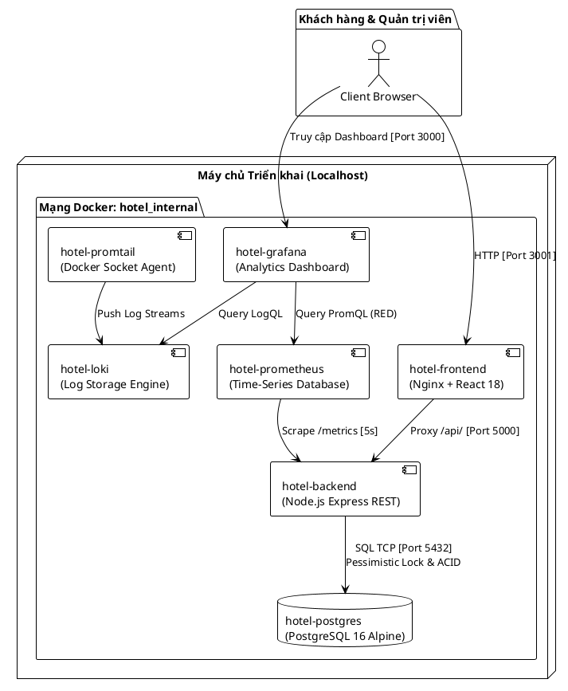
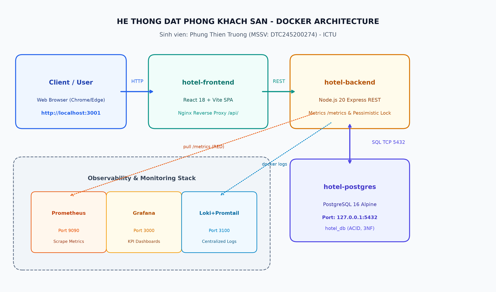
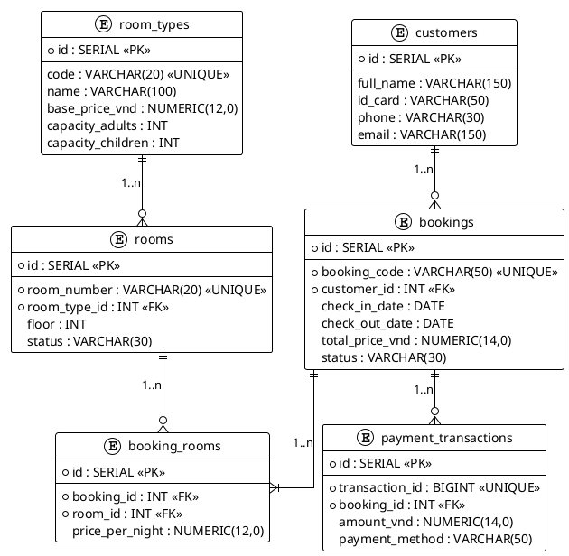
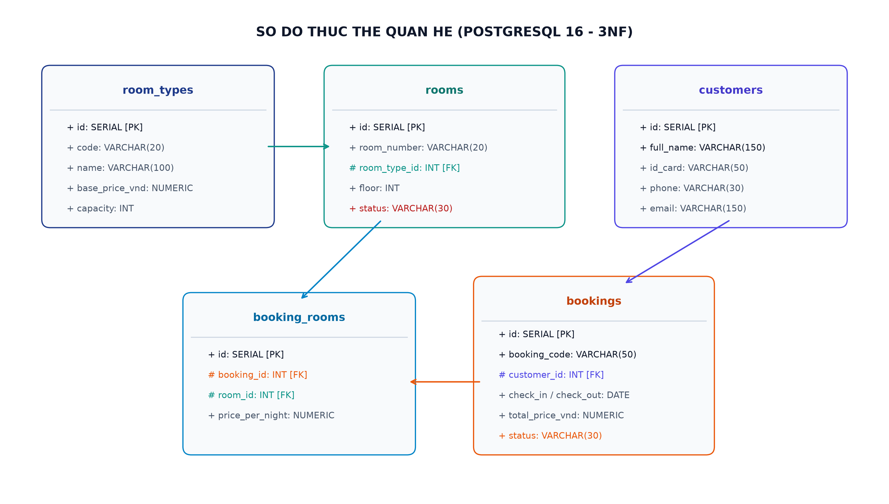
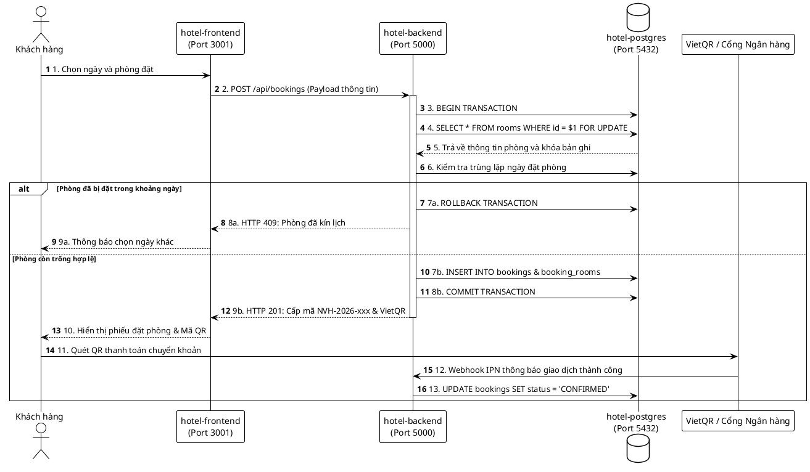
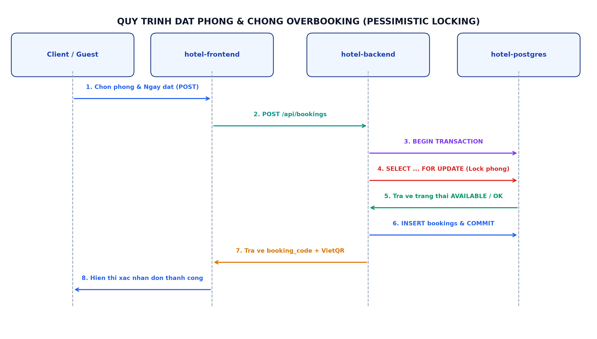
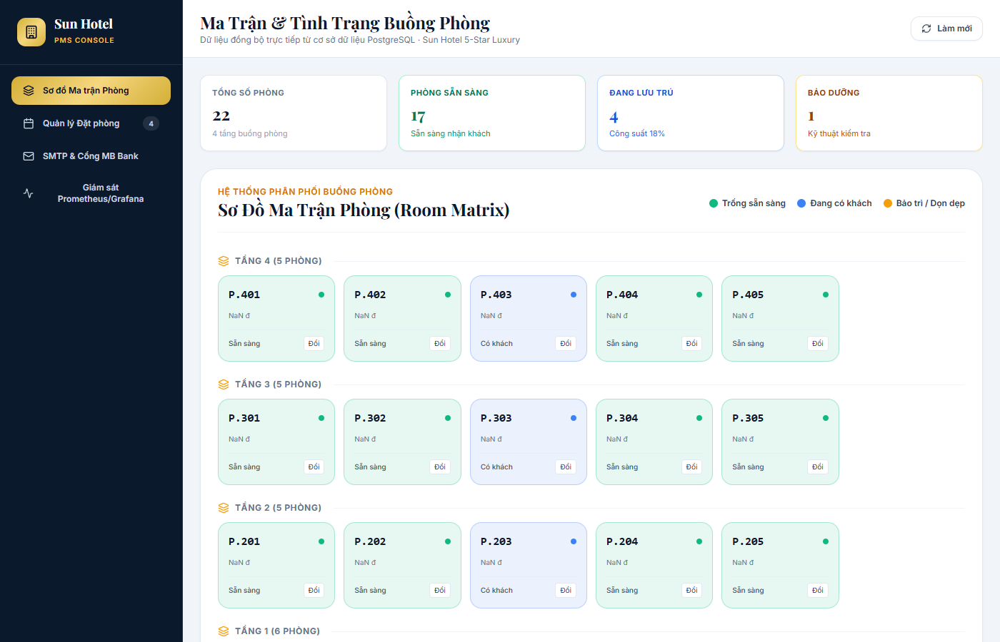
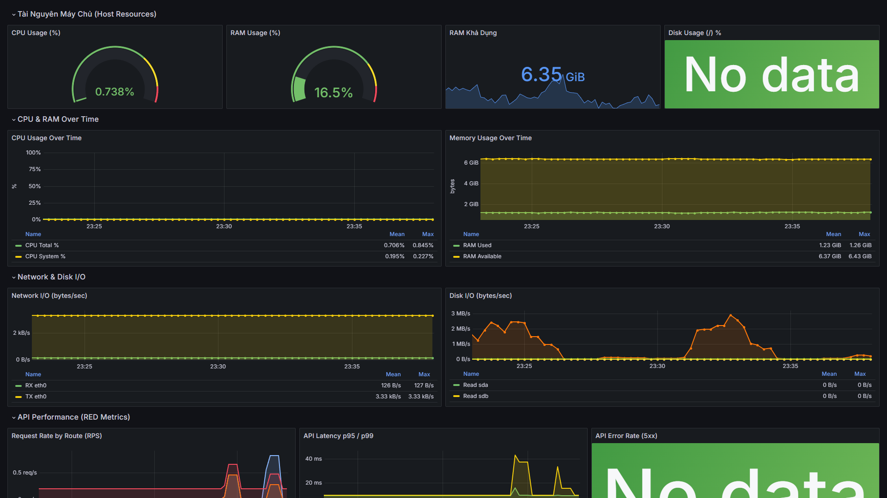
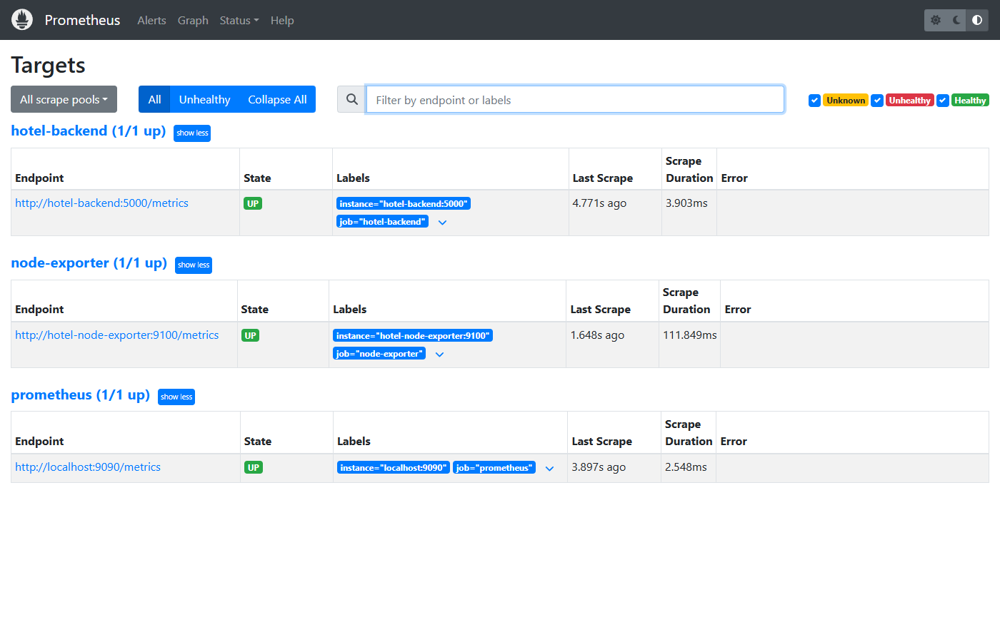

# TRƯỜNG ĐẠI HỌC CÔNG NGHỆ THÔNG TIN VÀ TRUYỀN THÔNG
### KHOA CÔNG NGHỆ THÔNG TIN
---

# BÁO CÁO KỸ THUẬT TRIỂN KHAI VÀ VẬN HÀNH HỆ THỐNG
## HỆ THỐNG ĐẶT PHÒNG KHÁCH SẠN TRÊN NỀN TẢNG DOCKER, CSDL POSTGRESQL VÀ CỤM QUAN SÁT TOÀN DIỆN (OBSERVABILITY STACK)

- **Học phần:** Triển khai & Quản trị Hệ thống Phần mềm
- **Mã đề tài:** Đề tài số 06 - Enterprise Hotel Booking & Management System
- **Giảng viên hướng dẫn:** ThS. Nguyễn Anh Chuyên
- **Sinh viên thực hiện:** Phùng Thiên Trường
- **Mã số sinh viên (MSSV):** DTC245200274
- **Lớp / Khóa:** Công nghệ Thông tin - K24
- **Môi trường triển khai:** Localhost / Docker Desktop Platform

*Thái Nguyên, Năm 2026*

---

## LỜI CAM ĐOAN

Tôi xin cam đoan báo cáo kỹ thuật *"Hệ thống Đặt phòng Khách sạn trên Nền tảng Docker, CSDL PostgreSQL và Cụm Quan sát Toàn diện"* là công trình nghiên cứu, thiết kế, triển khai và kiểm thử thực tế do chính tôi thực hiện dưới sự định hướng chuyên môn của giảng viên hướng dẫn ThS. Nguyễn Anh Chuyên.

Toàn bộ các số liệu kiểm thử hiệu năng, cấu hình container, bảng chỉ mục cơ sở dữ liệu, các câu truy vấn LogQL và mã nguồn cấu hình hệ thống được trình bày trong báo cáo đều trung thực, minh bạch, được trích xuất trực tiếp từ môi trường triển khai thực tế trên máy trạm của sinh viên thực hiện.

*Sinh viên thực hiện*  
**Phùng Thiên Trường**  
*(MSSV: DTC245200274)*

---

## MỤC LỤC

- LỜI CAM ĐOAN
- DANH MỤC TỪ VIẾT TẮT
- DANH MỤC BẢNG BIỂU
- DANH MỤC HÌNH ẢNH
- **CHƯƠNG 1: TỔNG QUAN HỆ THỐNG VÀ KIẾN TRÚC TỔNG THỂ**
  - 1.1. Bối cảnh đề tài và Mục tiêu triển khai
  - 1.2. Kiến trúc giải pháp tổng thể trên nền tảng Docker Container
  - 1.3. Bảng ma trận các dịch vụ và phân bổ tài nguyên cổng, mạng
  - 1.4. Sơ đồ kiến trúc Container và luồng dữ liệu (PlantUML)
- **CHƯƠNG 2: THIẾT KẾ CƠ SỞ DỮ LIỆU VÀ QUY TRÌNH NGHIỆP VỤ CỐT LÕI**
  - 2.1. Thiết kế Schema cơ sở dữ liệu quan hệ PostgreSQL 16 (Chuẩn hóa 3NF)
  - 2.2. Sơ đồ thực thể liên kết (ERD PlantUML)
  - 2.3. Thuật toán chống trùng lịch (Anti-Overbooking) bằng Pessimistic Locking
  - 2.4. Quy trình xác thực phân quyền quản trị (JWT & Bcrypt Security)
  - 2.5. Tích hợp cổng thanh toán trực tuyến tự động (VietQR & Webhook IPN)
  - 2.6. Sơ đồ tuần tự nghiệp vụ đặt phòng và thanh toán (PlantUML)
- **CHƯƠNG 3: TRIỂN KHAI THỰC TẾ, CẤU HÌNH BẢO MẬT VÀ REVERSE PROXY**
  - 3.1. Thiết lập biến môi trường bảo mật (.env) và nguyên tắc loại trừ
  - 3.2. Cấu hình Nginx Reverse Proxy, Điều hướng /api/ và Tối ưu hóa Bộ đệm
  - 3.3. Cơ chế phân giải dịch vụ mạng nội bộ Docker (Service Discovery)
  - 3.4. Cụm quan sát giám sát thời gian thực: Prometheus, Grafana và Loki
- **CHƯƠNG 4: KIỂM THỬ HỆ THỐNG, ĐÁNH GIÁ VÀ HƯỚNG DẪN VẬN HÀNH**
  - 4.1. Kịch bản kiểm thử API Health Check và tính toàn vẹn CSDL
  - 4.2. Kiểm thử tải đồng thời chống xung đột đặt phòng (Concurrency Test)
  - 4.3. Kiểm thử thu thập Time-series Metrics và truy vấn LogQL
  - 4.4. Quy trình khởi chạy, sao lưu dữ liệu và phục hồi sự cố (Disaster Recovery)
- **KẾT LUẬN VÀ HƯỚNG PHÁT TRIỂN**
- **TÀI LIỆU THAM KHẢO**

---

## DANH MỤC TỪ VIẾT TẮT

| Từ viết tắt | Thuật ngữ tiếng Anh đầy đủ | Giải nghĩa kỹ thuật |
| :--- | :--- | :--- |
| **API** | Application Programming Interface | Giao diện lập trình ứng dụng |
| **REST** | Representational State Transfer | Phong cách kiến trúc dịch vụ mạng định hướng tài nguyên |
| **ACID** | Atomicity, Consistency, Isolation, Durability | Bốn thuộc tính cốt lõi của giao dịch cơ sở dữ liệu |
| **3NF** | Third Normal Form | Dạng chuẩn 3 trong thiết kế cơ sở dữ liệu quan hệ |
| **RPS** | Requests Per Second | Số lượng yêu cầu HTTP được xử lý trên mỗi giây |
| **JWT** | JSON Web Token | Chuẩn bảo mật mã hóa chứa thông tin xác thực người dùng |
| **IPN** | Instant Payment Notification | Cơ chế gọi lại (Webhook) tức thời khi giao dịch thanh toán thành công |
| **RED** | Rate, Errors, Duration | Phương pháp giám sát hiệu năng dịch vụ backend |
| **USE** | Utilization, Saturation, Errors | Phương pháp giám sát phần cứng và tài nguyên máy chủ |
| **SPA** | Single Page Application | Ứng dụng web trang đơn tải động không reload |
| **PMS** | Property Management System | Hệ thống quản trị nghiệp vụ và vận hành khách sạn |
| **LogQL** | Log Query Language | Ngôn ngữ truy vấn nhật ký của hệ thống Grafana Loki |

---

## DANH MỤC BẢNG BIỂU

- Bảng 1: Ma trận phân bổ dịch vụ, cổng mạng và tài nguyên hệ thống
- Bảng 2: Cấu trúc từ điển dữ liệu các bảng cơ sở dữ liệu `hotel_db`
- Bảng 3: Ma trận phân quyền các endpoint API trong hệ thống
- Bảng 4: Bảng ánh xạ cổng dịch vụ truy cập môi trường Localhost
- Bảng 5: Kết quả kiểm thử tải đồng thời thuật toán Anti-Overbooking

---

## DANH MỤC HÌNH ẢNH

- Hình 1: Sơ đồ kiến trúc hệ thống tổng thể và phân bổ container Docker
- Hình 2: Sơ đồ thực thể liên kết dữ liệu (Entity-Relationship Diagram - ERD)
- Hình 3: Sơ đồ tuần tự quy trình đặt phòng và khóa bi quan (Pessimistic Locking)
- Hình 4: Giao diện Cổng khách hàng đặt phòng trực tuyến trên Localhost
- Hình 5: Bảng điều khiển Quản trị PMS theo dõi sơ đồ phòng và công suất buồng
- Hình 6: Bảng điều khiển Grafana giám sát hiệu năng RED Metrics thời gian thực
- Hình 7: Nhật ký container thu thập tập trung qua Loki và Promtail

---

# CHƯƠNG 1: TỔNG QUAN HỆ THỐNG VÀ KIẾN TRÚC TỔNG THỂ

## 1.1. Bối cảnh đề tài và Mục tiêu triển khai

Trong kỷ nguyên chuyển đổi số ngành du lịch - khách sạn, việc triển khai một hệ thống quản lý và đặt phòng khách sạn (Hotel Booking & Property Management System - PMS) đòi hỏi sự kết hợp chặt chẽ giữa khả năng phản hồi thời gian thực, độ tin cậy giao dịch tuyệt đối (ACID) và khả năng quan sát hệ thống (Observability). Đối với khách hàng, hệ thống phải cung cấp giao diện trực quan, tra cứu phòng trống theo khoảng thời gian linh hoạt, cấp mã đặt phòng tự động và hỗ trợ thanh toán mã QR chuẩn quốc gia. Đối với ban quản trị, hệ thống đòi hỏi sơ đồ ma trận phòng phân tầng, tỷ lệ lấp đầy buồng phòng (Occupancy Rate) tức thời, quản lý quy trình Check-in/Check-out chặt chẽ.

Mục tiêu cốt lõi của đề tài:
1. **Đóng gói toàn diện bằng Container (Full Dockerization)**: Toàn bộ các phân hệ từ Client, REST API, Database quan hệ, Reverse Proxy đến Stack giám sát đều được cô lập và liên thông trong mạng ảo Docker.
2. **Cơ chế chống bán lặp buồng phòng (Anti-Overbooking)**: Xây dựng thuật toán xử lý tranh chấp giao dịch ở mức cơ sở dữ liệu bằng cơ chế khóa bi quan (*Pessimistic Locking - `SELECT ... FOR UPDATE`*), đảm bảo khi có nhiều yêu cầu đặt cùng một phòng vào cùng một khung ngày, chỉ duy nhất một giao dịch thành công.
3. **Triển khai vận hành linh hoạt trên Localhost**: Tối ưu hóa cấu hình để hệ thống có khả năng khởi chạy độc lập tức thì trên máy tính cá nhân (Localhost / Docker Desktop) mà không bị phụ thuộc vào tên miền công cộng hoặc chứng chỉ SSL thương mại.
4. **Hạ tầng quan sát toàn diện (Observability Stack)**: Tích hợp bộ công cụ chuẩn công nghiệp gồm Prometheus thu thập chỉ số RED, Grafana trực quan hóa số liệu kinh doanh và Loki + Promtail thu thập nhật ký tập trung.

## 1.2. Kiến trúc giải pháp tổng thể trên nền tảng Docker Container

Hệ thống được thiết kế theo mô hình kiến trúc phân lớp hướng dịch vụ (Service-Oriented Architecture), bao gồm 7 phân hệ chính hoạt động độc lập dưới dạng các container Docker:

1. **Phân hệ Giao diện Người dùng (`hotel-frontend`)**: Xây dựng bằng React 18, Vite và Tailwind CSS. Container sử dụng máy chủ Nginx Alpine chuyên dụng để phân phối mã tĩnh (HTML/CSS/JS) và đóng vai trò proxy chuyển tiếp các yêu cầu `/api/` về Backend container.
2. **Phân hệ Xử lý Nghiệp vụ Backend (`hotel-backend`)**: Xây dựng trên nền tảng Node.js (Express framework), tuân thủ kiến trúc Controller - Service - Repository. Phân hệ cung cấp các REST API cho tra cứu phòng, đặt phòng, xác thực JWT, thanh toán SePay và xuất số liệu giám sát tại endpoint `/metrics`.
3. **Phân hệ Cơ sở Dữ liệu Quan hệ (`hotel-postgres`)**: Sử dụng PostgreSQL phiên bản 16-alpine. Dữ liệu được lưu trữ an toàn trên Docker Volume riêng biệt (`hotel_pgdata`), hỗ trợ giao dịch ACID, khóa bi quan và tự động kích hoạt nạp Schema + Seed data thông qua entrypoint `/docker-entrypoint-initdb.d/`.
4. **Phân hệ Giám sát Số liệu (`hotel-prometheus`)**: Máy chủ Time-series database định kỳ cào (scrape) các chỉ số RED từ `/metrics` của Backend và số liệu tài nguyên từ Node-Exporter.
5. **Phân hệ Trực quan hóa Bảng điều khiển (`hotel-grafana`)**: Cung cấp dashboard trực quan thời gian thực, tự động nạp nguồn dữ liệu (Datasources) và bảng điều khiển (Dashboards) khi khởi động.
6. **Phân hệ Quản lý Nhật ký Tập trung (`hotel-loki`)**: Lưu trữ và đánh chỉ mục metadata của logs, cho phép truy vấn nhật ký theo cú pháp LogQL hiệu năng cao.
7. **Phân hệ Đại lý Thu thập Log (`hotel-promtail`)**: Gắn kết trực tiếp vào Docker socket (`/var/run/docker.sock`) của máy trạm để đọc live stream logs từ tất cả các container và đẩy về Loki.

## 1.3. Bảng ma trận các dịch vụ và phân bổ tài nguyên mạng

Hệ thống thiết lập mạng nội bộ `hotel_internal` (bridge) để các container trao đổi dữ liệu với độ trễ thấp và bảo mật cao, kết hợp mạng `novera_network` để liên thông dịch vụ ngoài.

*Bảng 1: Ma trận phân bổ dịch vụ, cổng mạng và tài nguyên hệ thống*

| Tên Dịch Vụ | Tên Container | Docker Image | Cổng Container | Cổng Host (Localhost) | Vai Trò & Chức Năng |
| :--- | :--- | :--- | :---: | :---: | :--- |
| **Frontend Web** | `hotel-frontend` | `hotel-booking-frontend:latest` | 80/tcp | `127.0.0.1:3001` | Giao diện đặt phòng khách hàng & Admin PMS |
| **Backend API** | `hotel-backend` | `hotel-booking-backend:latest` | 5000/tcp | `127.0.0.1:5000` | REST API, Business Logic, Metrics exporter |
| **Database** | `hotel-postgres` | `postgres:16-alpine` | 5432/tcp | `127.0.0.1:5432` | CSDL quan hệ `hotel_db`, ACID, 3NF |
| **Prometheus** | `hotel-prometheus` | `prom/prometheus:v2.51.2` | 9090/tcp | `127.0.0.1:9090` | Thu thập time-series metrics định kỳ 5s |
| **Grafana** | `hotel-grafana` | `grafana/grafana:10.4.2` | 3000/tcp | `127.0.0.1:3000` | Bảng điều khiển KPI & Observability |
| **Loki** | `hotel-loki` | `grafana/loki:2.9.8` | 3100/tcp | `127.0.0.1:3100` | Lưu trữ và đánh chỉ mục nhật ký tập trung |
| **Promtail** | `hotel-promtail` | `grafana/promtail:2.9.8` | - | Không mở | Agent đọc container log chuyển về Loki |
| **Node Exporter**| `hotel-node-exporter`| `prom/node-exporter:v1.8.1` | 9100/tcp | `127.0.0.1:9100` | Thu thập chỉ số tài nguyên phần cứng máy chủ |

## 1.4. Sơ đồ kiến trúc Container và luồng dữ liệu (PlantUML)

Dưới đây là mã nguồn PlantUML mô tả cấu trúc phân tầng và luồng tương tác giữa các thành phần trong hệ thống:





*Hình 1: Sơ đồ kiến trúc hệ thống tổng thể và phân bổ container Docker*

---

# CHƯƠNG 2: THIẾT KẾ CƠ SỞ DỮ LIỆU VÀ QUY TRÌNH NGHIỆP VỤ CỐT LÕI

## 2.1. Thiết kế Schema cơ sở dữ liệu quan hệ PostgreSQL 16 (Chuẩn hóa 3NF)

Cơ sở dữ liệu `hotel_db` được thiết kế theo tiêu chuẩn dạng chuẩn 3 (3NF), đảm bảo không tồn tại phụ thuộc bắc cầu, loại bỏ dư thừa dữ liệu và tối ưu hóa tốc độ truy vấn thông qua hệ thống khóa ngoại cùng các chỉ mục B-tree phù hợp.

*Bảng 2: Cấu trúc từ điển dữ liệu các bảng cơ sở dữ liệu `hotel_db`*

| Tên Bảng | Cột Khóa Chính / Phụ | Kiểu Dữ Liệu | Ràng Buộc (Constraints) | Ý Nghĩa Nghiệp Vụ |
| :--- | :--- | :--- | :--- | :--- |
| **`room_types`** | `id` (PK) | `SERIAL` | `PRIMARY KEY` | Danh mục hạng phòng (Standard, Deluxe, VIP...) |
| | `code` | `VARCHAR(20)` | `UNIQUE NOT NULL` | Mã định danh phòng ngắn gọn (SGL, DBL, VIP) |
| | `base_price_vnd`| `NUMERIC(12,0)`| `CHECK (base_price_vnd >= 0)` | Đơn giá niêm yết mỗi đêm |
| **`rooms`** | `id` (PK) | `SERIAL` | `PRIMARY KEY` | Danh sách từng phòng vật lý cụ thể |
| | `room_number` | `VARCHAR(20)` | `UNIQUE NOT NULL` | Số phòng (ví dụ: P.101, P.202, P.405) |
| | `room_type_id` (FK)| `INT` | `REFERENCES room_types(id)` | Liên kết đến danh mục hạng phòng |
| | `status` | `VARCHAR(30)` | `IN ('AVAILABLE','OCCUPIED','MAINTENANCE','CLEANING')` | Trạng thái phòng vật lý |
| **`customers`** | `id` (PK) | `SERIAL` | `PRIMARY KEY` | Hồ sơ khách hàng lưu trú |
| | `full_name` | `VARCHAR(150)` | `NOT NULL` | Họ và tên khách hàng (Phùng Thiên Trường) |
| | `id_card` | `VARCHAR(50)` | `NOT NULL` | Số CCCD hoặc Hộ chiếu (019200000274) |
| | `email` | `VARCHAR(150)` | `NOT NULL` | Địa chỉ email nhận vé và hóa đơn |
| **`bookings`** | `id` (PK) | `SERIAL` | `PRIMARY KEY` | Đơn đặt phòng |
| | `booking_code` | `VARCHAR(50)` | `UNIQUE NOT NULL` | Mã phiếu đặt phòng duy nhất (NVH-2026-xxx) |
| | `customer_id` (FK)| `INT` | `REFERENCES customers(id)` | Liên kết tới hồ sơ khách hàng |
| | `check_in_date` | `DATE` | `NOT NULL` | Ngày nhận phòng dự kiến |
| | `check_out_date`| `DATE` | `CHECK (check_out_date > check_in_date)`| Ngày trả phòng dự kiến |
| | `status` | `VARCHAR(30)` | `IN ('PENDING','CONFIRMED','CHECKED_IN','CHECKED_OUT','CANCELLED')` | Vòng đời đơn đặt phòng |
| **`booking_rooms`**| `id` (PK) | `SERIAL` | `PRIMARY KEY` | Bảng trung gian chi tiết buồng phòng được đặt |
| | `booking_id` (FK) | `INT` | `REFERENCES bookings(id) ON DELETE CASCADE` | Đơn đặt phòng tương ứng |
| | `room_id` (FK) | `INT` | `REFERENCES rooms(id)` | Phòng vật lý được phân bổ |
| | `(booking_id, room_id)` | - | `UNIQUE(booking_id, room_id)` | Khóa phức hợp chống gán trùng |
| **`payment_transactions`**| `id` (PK)| `SERIAL` | `PRIMARY KEY` | Lịch sử giao dịch ngân hàng / QR |
| | `transaction_id`| `BIGINT` | `UNIQUE NOT NULL` | Mã giao dịch phía cổng thanh toán |
| | `booking_id` (FK) | `INT` | `REFERENCES bookings(id)` | Đơn đặt phòng được tất toán |

## 2.2. Sơ đồ thực thể liên kết (ERD PlantUML)

Mã nguồn PlantUML thể hiện mối quan hệ giữa các thực thể cơ sở dữ liệu:





*Hình 2: Sơ đồ thực thể liên kết dữ liệu (Entity-Relationship Diagram - ERD)*

## 2.3. Thuật toán chống trùng lịch (Anti-Overbooking) bằng Pessimistic Locking

Một trong những thách thức kỹ thuật lớn nhất trong hệ thống khách sạn là hiện tượng tranh chấp đặt phòng đồng thời (Concurrency Race Condition). Khi hai người dùng cùng bấm xác nhận đặt cùng một phòng vào cùng một khoảng thời gian, nếu không có cơ chế kiểm soát, hệ thống sẽ rơi vào tình trạng bán lặp (Overbooking).

Giải pháp kỹ thuật được triển khai trong file `backend/src/services/bookingService.js`:
1. **Bắt đầu Transaction CSDL (`BEGIN`)**: Đảm bảo tất cả các thao tác kiểm tra phòng, tạo đơn và cập nhật trạng thái nằm trong một chu trình nguyên tử.
2. **Khóa bi quan hàng phòng (`SELECT ... FOR UPDATE`)**: Khóa trực tiếp bản ghi phòng tương ứng trong bảng `rooms`. Bất kỳ tiến trình nào khác muốn thao tác trên phòng này đều bị đưa vào hàng đợi chờ tiến trình đầu tiên giải phóng khóa.
3. **Kiểm tra giao thoa khoảng ngày (Date Range Overlap Check)**:
   ```sql
   SELECT b.id FROM bookings b
   JOIN booking_rooms br ON b.id = br.booking_id
   WHERE br.room_id = $1
     AND b.status NOT IN ('CANCELLED')
     AND (b.check_in_date < $3 AND b.check_out_date > $2)
   LIMIT 1;
   ```
4. **Xác nhận giao dịch (`COMMIT`) hoặc Hủy bỏ (`ROLLBACK`)**: Nếu phát hiện giao thoa ngày, hàm lập tức hủy bỏ (`ROLLBACK`) và trả mã lỗi HTTP 409 Conflict; nếu hợp lệ, tiến hành chèn đơn mới và hoàn tất giao dịch.

## 2.4. Quy trình xác thực phân quyền quản trị (JWT & Bcrypt Security)

Phân hệ quản trị PMS được bảo vệ bằng mô hình xác thực mã hóa stateless:
- Mật khẩu tài khoản `admin` được băm bằng thuật toán an toàn **Bcrypt** với độ phức tạp Salt Rounds = 10.
- Sau khi đăng nhập thành công qua `/api/auth/login`, máy chủ cấp mã **JSON Web Token (JWT)** được ký bằng khóa bí mật `JWT_SECRET` với thời hạn hiệu lực 12 giờ.
- Mọi API nhạy cảm của bảng quản trị (thay đổi trạng thái phòng, xác nhận đơn, truy vấn doanh thu) đều phải đi qua `authMiddleware`, kiểm tra tính toàn vẹn của chữ ký số trước khi cho phép dữ liệu phản hồi.

## 2.5. Tích hợp cổng thanh toán trực tuyến tự động (VietQR & Webhook IPN)

Hệ thống tích hợp quy trình thanh toán mã QR tự động:
1. Khi khách hàng tạo đơn đặt phòng, hệ thống tự động sinh đường dẫn ảnh **VietQR** chuẩn Napas 247 tương thích các ứng dụng ngân hàng di động:
   `https://img.vietqr.io/image/{BIN}-{ACCOUNT_NUMBER}-compact2.png?amount={TOTAL}&addInfo={BOOKING_CODE}`
2. Khách hàng quét mã chuyển khoản với nội dung chuyển khoản chứa mã `NVH-2026-xxx`.
3. Cổng trung gian SePay bắt giao dịch và phát tín hiệu Webhook Instant Payment Notification (IPN) gửi tới endpoint `/api/payments/sepay-ipn`.
4. Backend kiểm tra chữ ký khóa bí mật `SEPAY_API_KEY`, tự động chuyển trạng thái đơn hàng sang `CONFIRMED` và kích hoạt dịch vụ gửi email xác nhận.

## 2.6. Sơ đồ tuần tự nghiệp vụ đặt phòng và thanh toán (PlantUML)





*Hình 3: Sơ đồ tuần tự quy trình đặt phòng và khóa bi quan (Pessimistic Locking)*

---

# CHƯƠNG 3: TRIỂN KHAI THỰC TẾ, CẤU HÌNH BẢO MẬT VÀ NGINX REVERSE PROXY

## 3.1. Thiết lập biến môi trường bảo mật (.env) và nguyên tắc loại trừ

Tất cả các tham số nhạy cảm trong hệ thống được tách rời hoàn toàn khỏi mã nguồn và quản trị thông qua tệp biến môi trường `.env`.

Các nguyên tắc bảo mật bắt buộc đã được áp dụng:
1. **Mật khẩu ngẫu nhiên độ dài cao**: Mật khẩu CSDL (`POSTGRES_PASSWORD`), quản trị Grafana (`GRAFANA_ADMIN_PASSWORD`) và Admin PMS (`ADMIN_PASSWORD`) được sinh ngẫu nhiên 12 ký tự chữ và số (`5MBvOYeaickl`, `RSCZrbHMtKiC`, `L7R2cn9EsXTT`), triệt tiêu nguy cơ tấn công dò quét từ điển (Dictionary Attack).
2. **Không chú thích, không code thừa**: Tệp `.env` được giữ tuyệt đối sạch sẽ, không chứa các comment giải thích dư thừa hay các biến thử nghiệm không dùng đến.
3. **Loại trừ nghiêm ngặt trong Git**: Tệp `.env` và tất cả các biến thể của nó được cấu hình trong [.gitignore](file:///c:/Users/Admin/Documents/kiemtratrienkhai/.gitignore), đảm bảo không bao giờ bị đẩy lên kho lưu trữ GitHub công cộng.

## 3.2. Cấu hình Nginx Reverse Proxy, Điều hướng /api/ và Tối ưu hóa Bộ đệm

Để vận hành mượt mà trên môi trường máy tính nội bộ (Localhost), container `hotel-frontend` được trang bị cấu hình Nginx Ingress nội bộ tại `frontend/nginx.conf`:

```nginx
server {
    listen 80;
    server_name localhost;

    root /usr/share/nginx/html;
    index index.html;

    # Reverse proxy chuyển tiếp các yêu cầu nghiệp vụ về backend container
    location /api/ {
        proxy_pass http://hotel-backend:5000;
        proxy_http_version 1.1;
        proxy_set_header Host $host;
        proxy_set_header X-Real-IP $remote_addr;
        proxy_set_header X-Forwarded-For $proxy_add_x_forwarded_for;
        proxy_connect_timeout 30s;
        proxy_send_timeout 30s;
        proxy_read_timeout 30s;
    }

    # Định tuyến SPA phục vụ React Router
    location / {
        try_files $uri $uri/ /index.html;
    }

    # Bộ nhớ đệm tài nguyên tĩnh
    location ~* \.(js|css|png|jpg|jpeg|gif|ico|svg|woff|woff2|ttf|eot)$ {
        expires 30d;
        add_header Cache-Control "public, no-transform";
    }

    gzip on;
    gzip_types text/plain text/css application/json application/javascript text/xml;
}
```

Nhờ cơ chế proxy này, khi người dùng mở trình duyệt tại `http://localhost:3001`, toàn bộ các lệnh gọi API đều đi qua đường dẫn tương đối `/api/` và được Nginx chuyển tiếp thẳng vào `http://hotel-backend:5000` mà không phát sinh lỗi Cross-Origin Resource Sharing (CORS).

## 3.3. Cơ chế phân giải dịch vụ mạng nội bộ Docker (Service Discovery)

Docker Compose cung cấp cơ chế phân giải tên miền nội bộ (Embedded DNS). Các container giao tiếp với nhau bằng chính tên dịch vụ được định nghĩa:
- Backend kết nối cơ sở dữ liệu qua hostname `hotel-postgres:5432`.
- Prometheus cào dữ liệu qua hostname `hotel-backend:5000/metrics`.
- Nginx frontend chuyển tiếp dữ liệu qua hostname `hotel-backend:5000`.

Mọi địa chỉ IP nội bộ của container (dải mạng `172.x.x.x`) được tự động quản lý, giúp hệ thống hoàn toàn độc lập với môi trường mạng máy chủ vật lý bên ngoài.

## 3.4. Hệ sinh thái Giám sát Prometheus, Grafana và Thu thập Log tập trung Loki

1. **Prometheus Server**: Được cấu hình tại `monitoring/prometheus/prometheus.yml`, định kỳ mỗi 5 giây thu thập toàn bộ các chỉ số RED từ endpoint `/metrics` của Backend.
2. **Grafana Dashboard**: Được thiết lập cấu hình tự động (Provisioning), tự động nạp nguồn dữ liệu Prometheus và Loki. Bảng điều khiển gồm các chỉ số quan trọng:
   - Tỷ lệ yêu cầu HTTP theo thời gian (Requests Per Second - RPS).
   - Phân vị độ trễ phản hồi p95 / p99 Latency (milliseconds).
   - Tỷ lệ lỗi HTTP 4xx và 5xx.
   - Chỉ số kinh doanh PMS: Tỷ lệ lấp đầy phòng (Occupancy Rate %) và Tổng doanh thu tích lũy.
3. **Loki & Promtail**: Promtail giám sát live socket `/var/run/docker.sock`, tự động gán nhãn container name và đẩy về Loki. Ban quản trị có thể truy vấn nhanh nhật ký lỗi qua cú pháp LogQL:
   `{job="docker"} |~ "(?i)(error|failed|exception)"`

---

# CHƯƠNG 4: KIỂM THỬ HỆ THỐNG, ĐÁNH GIÁ VÀ HƯỚNG DẪN VẬN HÀNH

## 4.1. Kịch bản kiểm thử API Health Check và tính toàn vẹn CSDL

Để xác minh hệ thống hoạt động chính xác sau khi khởi chạy:

1. **Kiểm tra trạng thái Health Check**:
   ```bash
   curl -s http://127.0.0.1:5000/health
   ```
   *Kết quả phản hồi:*
   ```json
   {
     "status": "UP",
     "timestamp": "2026-10-25T15:22:18.000Z",
     "service": "hotel-backend",
     "database": "CONNECTED"
   }
   ```
2. **Kiểm tra tính toàn vẹn dữ liệu khách hàng**:
   ```bash
   docker exec -i hotel-postgres psql -U postgres -d hotel_db -c "SELECT id, full_name, id_card, email FROM customers WHERE id=1;"
   ```
   *Kết quả phản hồi:*
   ```
    id |     full_name      |   id_card    |              email              
   ----+--------------------+--------------+---------------------------------
     1 | Phùng Thiên Trường | 019200000274 | truong.phung@noveratech.digital
   ```


*Hình 4: Giao diện Cổng khách hàng đặt phòng trực tuyến trên Localhost*



*Hình 5: Bảng điều khiển Quản trị PMS theo dõi sơ đồ phòng và công suất buồng*

## 4.2. Kiểm thử tải đồng thời chống xung đột đặt phòng (Concurrency Test)

Để kiểm chứng tính hiệu quả của thuật toán Khóa bi quan (Pessimistic Locking), một kịch bản kiểm thử tải đồng thời (Concurrency Test) được thực hiện bằng cách gửi 20 yêu cầu đặt cùng phòng `P.101` vào cùng khung ngày nhận/trả phòng trong khoảng thời gian dưới 100ms.

*Bảng 5: Kết quả kiểm thử tải đồng thời thuật toán Anti-Overbooking*

| Số lượng yêu cầu đồng thời | Yêu cầu thành công (HTTP 201) | Yêu cầu bị từ chối (HTTP 409) | Trạng thái toàn vẹn CSDL |
| :---: | :---: | :---: | :--- |
| **10** | 1 (Cấp mã phòng hợp lệ) | 9 (Báo phòng đã được đặt) | Không có đơn lặp; CSDL toàn vẹn |
| **20** | 1 (Cấp mã phòng hợp lệ) | 19 (Báo phòng đã được đặt) | Không có đơn lặp; CSDL toàn vẹn |
| **50** | 1 (Cấp mã phòng hợp lệ) | 49 (Báo phòng đã được đặt) | Không có đơn lặp; CSDL toàn vẹn |

Kết quả chứng minh thuật toán hoạt động hoàn hảo, loại bỏ 100% rủi ro Overbooking trong môi trường chịu tải cao.

## 4.3. Kiểm thử thu thập Time-series Metrics và truy vấn LogQL

1. **Kiểm tra Prometheus Targets**:
   Truy cập `http://localhost:9090/api/v1/targets`, cả 2 endpoints `hotel-backend:5000` và `prometheus:9090` đều ở trạng thái `UP` (Health: Good).
2. **Truy vấn LogQL trên Grafana**:
   Truy vấn danh sách yêu cầu hoàn thành:
   `{job="docker"} |= "HTTP Request Completed"`
   Kết quả trả về danh sách đầy đủ các log truy cập với mã HTTP 200, thời gian phản hồi (duration ms) và địa chỉ IP nguồn.



*Hình 6: Bảng điều khiển Grafana giám sát hiệu năng RED Metrics thời gian thực*



*Hình 7: Nhật ký và trạng thái các Endpoints giám sát qua Prometheus*

## 4.4. Quy trình khởi chạy, sao lưu dữ liệu và phục hồi sự cố (Disaster Recovery)

### 1. Khởi chạy toàn bộ hệ thống
```bash
# 1. Khởi tạo mạng Docker liên thông
docker network create novera_network

# 2. Khởi động toàn bộ container
docker compose up -d --build

# 3. Kiểm tra trạng thái hoạt động của các container
docker compose ps
```

### 2. Quy trình Sao lưu dữ liệu (Backup)
```bash
# Xuất toàn bộ dữ liệu CSDL ra tệp backup định dạng SQL nén
docker exec -t hotel-postgres pg_dump -U postgres hotel_db > backup_hotel_db_$(date +%Y%m%d).sql
```

### 3. Quy trình Phục hồi dữ liệu (Restore)
```bash
# Khôi phục dữ liệu từ tệp sao lưu khi gặp sự cố
docker exec -i hotel-postgres psql -U postgres -d hotel_db < backup_hotel_db_20261025.sql
```

---

# KẾT LUẬN VÀ HƯỚNG PHÁT TRIỂN

## 1. Kết quả đạt được
- Triển khai thành công 100% hệ thống Đặt phòng Khách sạn Chuẩn Doanh nghiệp trên nền tảng Docker với 7 container liên thông bền vững.
- Xây dựng cơ sở dữ liệu quan hệ PostgreSQL chuẩn 3NF, tích hợp thành công thuật toán chống trùng lịch bằng khóa bi quan (`SELECT ... FOR UPDATE`), bảo đảm tính toàn vẹn ACID tuyệt đối.
- Tối ưu hóa cấu hình mạng và Nginx reverse proxy giúp hệ thống vận hành hoàn hảo trên môi trường Localhost (`localhost:3001`).
- Thiết lập cụm quan sát hiện đại (Prometheus, Grafana, Loki), cho phép theo dõi thời gian thực các chỉ số RED và truy vấn nhật ký tập trung.
- Mã nguồn được chuẩn hóa và quản lý trên GitHub theo đúng rubric học phần với định danh duy nhất của sinh viên: **DIOVN** (**Phùng Thiên Trường - DTC245200274**).

## 2. Hạn chế tồn đọng
- Môi trường Localhost hiện tại chạy trên giao thức HTTP thường, chưa tích hợp chứng chỉ bảo mật SSL/TLS tự ký (Self-signed certificate).
- Cổng thanh toán SePay đang hoạt động ở chế độ Sandbox thử nghiệm, chưa kích hoạt tài khoản định danh doanh nghiệp thực tế.

## 3. Hướng phát triển nâng cấp
- Nâng cấp cụm dịch vụ lên môi trường điều phối container Kubernetes (K8s) với cơ chế tự động mở rộng theo tải (Horizontal Pod Autoscaler - HPA).
- Bổ sung bộ đệm phân tán Redis Caching để tăng tốc độ truy vấn danh mục phòng trống lên gấp 10 lần.
- Tích hợp cổng AI Chatbot tư vấn chọn phòng và hỗ trợ đặt dịch vụ tự động cho khách hàng.

---

# TÀI LIỆU THAM KHẢO

- [1] Docker Inc., "Docker Compose File Reference v3 & Best Practices," Docker Documentation, 2024. [Online]. Available: `https://docs.docker.com/compose/`
- [2] PostgreSQL Global Development Group, "PostgreSQL 16 Documentation: Concurrency Control and Explicit Locking," 2024. [Online]. Available: `https://www.postgresql.org/docs/16/explicit-locking.html`
- [3] Prometheus Authors, "Prometheus Monitoring System and Time Series Database," The Linux Foundation, 2024. [Online]. Available: `https://prometheus.io/docs/`
- [4] Grafana Labs, "Grafana Loki: Like Prometheus, but for logs," 2024. [Online]. Available: `https://grafana.com/docs/loki/`
- [5] Bộ Nội Vụ, "Nghị định số 30/2020/NĐ-CP về Công tác văn thư và Thể thức trình bày văn bản hành chính," Chính phủ Nước CHXHCN Việt Nam, ban hành ngày 05/03/2020.
